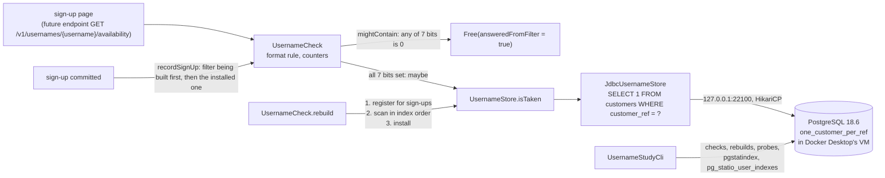

# Architecture

SeatWave's username Bloom filter and its visitor and seat counters: a Bloom filter sized from an item count and a target false-positive rate, a username check that asks the filter first and the database only on "maybe", a counting filter for deletes, HyperLogLog for unique visitors and a count-min sketch for the most-viewed seats; and a reduced-scale study that runs the username check against PostgreSQL 18.6. This is the project of Module 21, "Bloom filters", of the course System Design Fundamentals.

## Packages

All code is under `io.plainround.seatwave.filters`.

| Package | What it holds | Needs a database |
|---|---|---|
| `bloom` | `SeededHash` (one seeded 64-bit hash and the k positions from it), `BloomSizing`, `BloomFilter`, `CountingBloomFilter`; the programs `FalsePositiveCli`, `DeleteDemoCli`, `HmacCostCli` | no |
| `signup` | `UsernameStore` (the system of record), `JdbcUsernameStore` (it on Module 13's `customers`), `UsernameCheck` (the filter in front of it, with the gap-free rebuild); `UsernameCheckCli` | `JdbcUsernameStore` only |
| `sketch` | `HyperLogLog`, `CountMinSketch`; `VisitorCountCli`, `TopSeatsCli` | no |
| `labs` | the three lab solutions: `TenMillionNamesCli`, `ReadsAvoidedCli` (`--postgres` reads through `JdbcUsernameStore`), `UniqueVisitorsLabCli` | `ReadsAvoidedCli --postgres` only |
| `study` | `LabSettings` and `LabDatabase` (the settings and the one pool), `UsernameLoader` and `LoadUsernamesCli` (fill `customers` with `fan_1` to `fan_N`), `UsernameStudyCli` (the measurements of Section 8) | yes, except `LabSettings` |

## The dependency rule

`bloom` and `sketch` depend on the JDK only, and every structure hashes through `SeededHash`. `signup` depends on `bloom` and on the JDBC interfaces. `study` and `labs` depend on `signup`, `bloom` and HikariCP; the PostgreSQL driver and Logback are on the runtime classpath only. Only the `*Cli` classes print or exit.

## Data flow

## Walk-throughs

**A check.** `UsernameCheck.check` validates the name against Module 13's `customer_ref_format` (length first, so a 10 MB name costs nothing), counts it, and asks the installed filter. If any of the name's 7 bits is 0 the answer is `Free(true)` and nothing else happens. Otherwise, or while no filter is installed, it reads the store; a store failure is an `IllegalStateException`, never a guessed "free".

**A rebuild.** `rebuild` creates a new filter and registers it as the filter being built, so every `recordSignUp` from then on also adds to it; then the store scans every name into it (on PostgreSQL one statement, so one MVCC snapshot); then it is installed. A name committed after the snapshot reaches the new filter through `recordSignUp`, and one committed before is in the scan. If the scan throws, the old filter (or none) stays installed.

**A sign-up.** After the insert commits, the service calls `recordSignUp`, which adds the name first to the filter being built and then to the installed one. In that order a rebuild that installs its filter between the two reads cannot leave the name out of it (the seed read the other way round; see the changelog).

## Decisions and trade-offs

- **One hash function, double hashing.** k positions from two 64-bit hashes (Kirsch and Mitzenmacher), so add and lookup share one function and k costs two hashes. Rejected: k independent hash functions, k times the cost for no measured gain (the measured rates match theory within 0.4 percent).
- **Atomic OR per bit.** `AtomicLongArray.accumulateAndGet` makes concurrent adds lose nothing. Rejected: a lock around the array (serializes sign-ups for no benefit) and a plain `long[]` (loses bits under concurrency: `race-demo.jsh` and the mutant run of `concurrentAddsFromEightThreadsLoseNoName`).
- **No remove on the plain filter.** Deletes need `CountingBloomFilter` at four times the memory; usernames do not need deletes, because a stale "maybe" costs one database read.
- **The database stays the authority.** The unique index `one_customer_per_ref` refuses a duplicate whatever the filter said; the stack test checks it.
- **HikariCP for the lab.** A connection per check would measure connection set-up, not the lookup.

## Invariants and where they are enforced

| Invariant | Enforced by | Tested by |
|---|---|---|
| the filter never says "absent" for an added name | one position function (`SeededHash.bitPositions`) for add and lookup; no method writes a 0; atomic OR | `neverReportsAbsentForAnyOfAMillionInsertedNames`, `concurrentAddsFromEightThreadsLoseNoName`, mutants |
| the installed filter knows every committed name | register before the scan, install after; `recordSignUp` reads the filter being built first | `aNameCommittedDuringTheScanIsInTheNewFilter`, `aSignUpAfterTheRebuildReachesTheInstalledFilter` |
| a failed rebuild changes nothing | install only after the scan returns | `aStoreFailureDuringARebuildLeavesTheOldFilterInPlace`, `aFailedFirstRebuildLeavesNoFilterSoEveryCheckReadsTheStore`, the stack test |
| no duplicate username | `one_customer_per_ref` in PostgreSQL | `theUniqueIndexRefusesADuplicateWhateverTheFilterSaid` (stack) |
| a counting filter removes only what it can find | `remove` checks every counter first; a saturated counter is never decremented | `CountingBloomFilterTest` |
| count-min never undercounts | positive adds only, the minimum over rows | `neverUndercountsAnySeat` |
